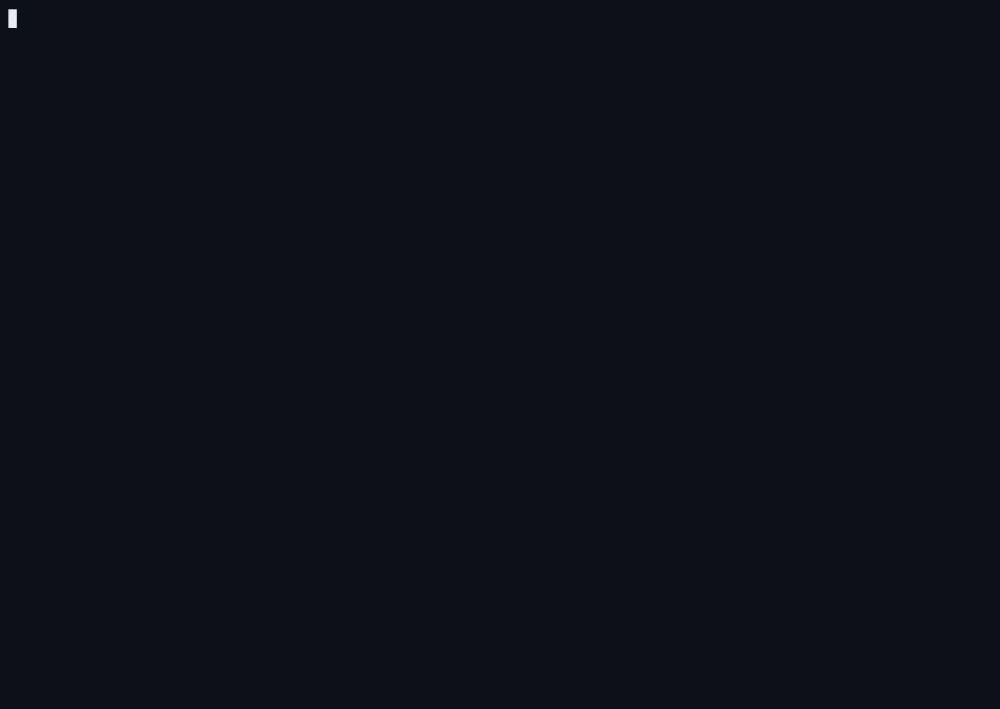

# ownable

`ownable` renders the tokens of a KVM piece straight from Ethereum, through
the piece's own contracts, using nothing but `eth_call`.

A KVM piece does not store pictures. It stores a program for the KVM, a small
bytecode virtual machine for generative art, and gives each token a seed. The
piece contract also names the contracts that turn the program and a seed into
an image: an interpreter that runs the program into a draw stream, and a
renderer that turns the draw stream into pixels. `ownable` asks the piece for
those inputs and contracts, then has the chain compute every pixel, so the
image you get is the image the contracts define. You trust your RPC endpoint
to execute the EVM correctly, and nothing else: no server, no image host, no
pre-rendered file.

Every call is a read. `ownable` never signs or sends a transaction.



`ownable verify` on Rakel #1 against an Ethereum mainnet RPC endpoint: the
token's published image is fetched from IPFS, the chain computes every pixel,
and the two are compared. The real run took 45 minutes; the recording is sped
up.

## Install

With Go 1.25 or later:

```
go install github.com/ownable-xyz/ownable-cli/cmd/ownable@latest
```

Or from a checkout, with the build script (it stamps the version and commit
into the binary):

```
git clone https://github.com/ownable-xyz/ownable-cli
cd ownable-cli
./build.sh            # Linux, macOS: bin/ownable
.\build.ps1           # Windows PowerShell: bin\ownable.exe
```

The result is a single static binary with no runtime dependencies.
`./build.sh --all` (or `.\build.ps1 -All`) builds every release platform
(Windows, Linux and macOS, amd64 and arm64) and writes `bin/SHA256SUMS`.
The builds are reproducible: the same commit and Go version give the same
bytes on any machine, so two people can compare their `SHA256SUMS`.

## Usage

You need an Ethereum mainnet JSON-RPC endpoint. Pass it with `--rpc`, or set
`OWNABLE_RPC_URL` (or `ETH_RPC_URL`). The examples use Rakel, a piece of 64
works at `0xe56522Ebaf8E19c7E2B9468Cbef8aF14773F5F18`.

```
export OWNABLE_RPC_URL=https://...

ownable info   0xe56522Ebaf8E19c7E2B9468Cbef8aF14773F5F18
ownable render 0xe56522Ebaf8E19c7E2B9468Cbef8aF14773F5F18 7 -o rakel-7.png
ownable verify 0xe56522Ebaf8E19c7E2B9468Cbef8aF14773F5F18 7
ownable verify 0xe56522Ebaf8E19c7E2B9468Cbef8aF14773F5F18 7 --against rakel-7.png
ownable render 0xe56522Ebaf8E19c7E2B9468Cbef8aF14773F5F18 7 --fork
```

`info` checks that the contract declares the `IKohiPiece` interface (ERC-165
id `0x9270a11e`) and prints its name, symbol, how many tokens are minted, the
rasterizer family and the render path (interpreter, stepped interpreter and
renderer addresses).

`render` writes a PNG and prints the number of calls, the total gas, the wall
time, the sha256 of the draw stream and the sha256 of the raw RGBA pixels. Two
people rendering the same token through two different endpoints get the same
two hashes.

`verify` renders the token the same way and compares the result with a PNG
pixel for pixel. It exits with status 1 when they differ. Without
`--against`, the PNG is the token's own published image, found through its
`tokenURI` (see [Verifying a render](#verifying-a-render)).

Useful flags:

| flag | meaning |
|------|---------|
| `--rpc URL` | the JSON-RPC endpoint |
| `-o FILE` | output PNG (default `<symbol>-<tokenId>.png`) |
| `--gas-cap N` | gas limit of every call (default 50,000,000) |
| `--band N` | raster band height in pixels (default 32) |
| `--workers N` | raster bands rendered at the same time (default 8) |
| `--meter MODE` | gas measurement: `auto`, `trace`, `estimate` or `off` |
| `--measure-every N` | measure one call in N after the first 8 (default 10; 1 for exact totals) |
| `--checkpoint FILE` | where interpreter progress is saved (default `<out>.ckpt`) |
| `--no-checkpoint` | do not save or resume progress |
| `--save-stream FILE` | also write the draw stream the chain produced |
| `--quiet` | print only the result lines |
| `--against REF` | `verify`: the image to compare with (a file, URL, `ipfs://` path or CID) |
| `--ipfs-gateway URL` | an IPFS gateway prefix; repeatable, tried in order |
| `--fetch-timeout D` | timeout of each download attempt (default 60s) |
| `--no-cache` | download the reference again instead of using the cache |
| `--fork` | render against a local anvil fork of `--rpc` (see [Fork mode](#fork-mode)) |
| `--fork-block N` | fork at block N instead of the latest |
| `--fork-url URL` | render against a node you already started |
| `--anvil PATH` | the anvil executable (default: `anvil` on PATH) |
| `--chunk-steps N` | interpreter steps per call in fork mode (default 2,000,000) |

Run `ownable help` for the full list.

## How a render works

1. **Read the piece.** `kohiProgram()`, `kohiParams()`, `kohiSeed(tokenId)` and
   `kohiRenderPath()` from the piece contract. The render path is the
   provenance statement: it names the contracts whose output is the artwork.
2. **Run the program.** The program goes through the piece's stepped
   interpreter (`KVMStepRunner.executeChunk`) in a chain of calls. Each call
   runs a bounded number of VM steps and returns a slice of the draw stream
   plus a snapshot of the VM state; the next call resumes from that snapshot.
   Growable state (the VM's linear memory, the open path, the noise table)
   stays with the client and is passed back in each call. The contract
   guarantees that the joined slices equal the stream of one uninterrupted
   run, wherever the chunk boundaries fall.
3. **Rasterize.** The draw stream goes through the piece's renderer. For the
   stamp family (family 3, used by Rakel) that is
   `StampRenderer.renderTileP`: the canvas is cut into horizontal bands, each
   band's drawing records are sent in slices, and every call threads the
   band's pixel buffer from the previous call back in. Each stamp record is
   self-describing and composited on its own, so a band only needs the stamps
   whose footprint touches it, and the result is identical to a one-shot
   render for any band height and any slice boundaries.
4. **Write the PNG** and print the hashes.

## The gas cap and how the work is split

A Rakel token is far too much work for one call. Measured on mainnet, token
1 took about 190 billion gas to run its program and 70 billion more to
rasterize; token 2 took about 350 billion and 50 billion. One call on a
public node is limited to tens of millions. So every call is sent with an
explicit gas limit (`--gas-cap`, default 50,000,000, the default `rpc.gascap`
of geth), and the work is cut so that each call fits:

- **Interpreter.** The step budget of each `executeChunk` call starts at
  30,000 and is tuned toward about 90% of the cap from the measured gas of
  earlier calls. A call that runs out of gas is retried from the same
  snapshot with half the budget, so a miss costs one call and loses nothing.
- **Renderer.** Each slice of a band is sized with a cost model: the calldata
  and memory cost of the threaded buffer, plus the pixels each stamp touches
  inside the band, scaled by a gas-per-pixel rate learned from measured
  calls. A slice that does not fit is halved. If a single stamp does not fit
  in a band, the band is split in half and rendered again.

Gas is measured with `debug_traceCall` when the node offers it, and with
`eth_estimateGas` otherwise. Measurement only feeds the sizing and the report;
the proof that the render fits the cap is that every `eth_call` succeeded
with `gas` set to the cap. Each measurement is one more request, so by default
the first 8 calls are measured and then one call in 10 (`--measure-every`),
and the report gives the total gas as an extrapolation from the measured
calls; `--measure-every 1` measures every call and reports the exact total.
Some nodes cap `eth_estimateGas` at 16,777,216 gas (the EIP-7825 transaction
limit), below most render calls, and `ownable` ignores estimates at that
ceiling; on such a node without `debug_traceCall` the gas is reported as not
measured, and the sizing falls back to growing after clean calls and backing
off after misses.

If the endpoint rate-limits requests (HTTP 429), `ownable` waits and retries,
and says how many requests were throttled.

Measured on a public endpoint, the full render of Rakel token 1 (each run
gave the same stream and pixel hashes, and an image identical to the
published one):

| gas cap | executeChunk calls | renderTileP calls | total calls | wall time |
|---------|--------------------|-------------------|-------------|-----------|
| 30,000,000 | 7,948 (+4 noise-table) | 2,780 | 10,732 | 21m32s |
| 50,000,000 | not recorded | not recorded | not recorded | about 14m |
| 60,000,000 | 4,467 (+2 noise-table) | 1,596 | 6,065 | 13m38s |

Nearly all the time is the interpreter, whose calls must run one after
another; the renderer's bands run in parallel and take about a minute. A
higher cap means fewer, larger calls, and the cap must not exceed what your
endpoint allows for `eth_call`. Tokens that need more gas (token 2 above)
take proportionally longer.

If a render is interrupted (Ctrl-C, a network failure), the interpreter's
progress is in `<out>.ckpt`; run the same command again to resume. The
checkpoint is your own local state, keyed to the program, seed, params and
interpreter, and removed once the PNG is written. Delete it to start clean.

## Verifying a render

`ownable verify <piece> <tokenId>` renders through the chain and compares
every pixel of the result with a reference image. The comparison is exact,
so the reference must be a lossless, full-size PNG (a resized or JPEG copy
will not match).

**The reference image is the claim under test.** A match proves that the
image is exactly what the piece's contracts compute for that token. The
render computed by the chain is the trust root; the host that served the
image (a gateway, a web server, a marketplace) is not trusted for anything,
and a host that served a different image would produce a mismatch.

Without `--against`, the reference is the token's own published image:
`verify` calls the piece's ERC-721 `tokenURI(tokenId)`, decodes the metadata
JSON and fetches its `"image"`. The metadata forms understood are:

- `data:application/json;base64,<base64>`
- `data:application/json;utf8,<json>`, the JSON as text with only `%`
  escaped as `%25` and `#` as `%23` (undone in a single left-to-right pass;
  nothing else is decoded, since the text holds raw spaces and quotes)
- `data:application/json,<percent-encoded json>`
- an `https://` or `ipfs://` URL (or a bare CID) that serves the JSON

With `--against REF`, the reference is whatever you name:

| REF | example |
|-----|---------|
| a local file | `--against rakel-1.png` |
| an `https://` URL | `--against https://example.org/rakel/1.png` |
| an IPFS path | `--against ipfs://bafybei.../1.png` |
| a bare CID or CID/path | `--against bafybei.../1.png` |
| a `data:` URI | `--against data:image/png;base64,...` |

IPFS references are fetched over HTTP through gateways, tried in order until
one answers, each attempt with a timeout (`--fetch-timeout`, default 60s).
The default list is `https://ipfs.filebase.io/ipfs/`,
`https://gateway.pinata.cloud/ipfs/`, `https://ipfs.io/ipfs/` and
`https://dweb.link/ipfs/`; public gateways change their policies, so pass
`--ipfs-gateway` (repeatable) to use others, such as your own node's
`http://127.0.0.1:8080/ipfs/`. Since the image is the claim under test, the
gateway's answer is not checked against the CID: a gateway that served the
wrong bytes would only cause a mismatch.

Downloads are cached under your user cache directory (`ownable/refs`), keyed
by the reference's URL (for IPFS, by `ipfs://CID/path`, whichever gateway
served it). `--no-cache` downloads again. The report prints where the
reference came from: the reference, the URL and gateway actually read (or
that it came from the cache), its size and its sha256.

The printed hashes are a quicker comparison: `stream sha256` identifies the
draw stream, and `rgba sha256` identifies the pixels (the sha256 of the raw
top-down RGBA bytes, independent of PNG compression).

## Fork mode

```
ownable verify 0xe56522Ebaf8E19c7E2B9468Cbef8aF14773F5F18 1 --fork --rpc https://...
```

`--fork` starts a local [anvil](https://getfoundry.sh) (Foundry's local
node) forked from `--rpc` at the endpoint's latest block, pinned to that
block number (`--fork-block N` picks another), on a free local port, with no
block gas limit. The whole render runs against it, and anvil is stopped
afterwards, also on Ctrl-C. anvil must be on your PATH (or pass `--anvil
PATH`); without it `--fork` stops with an error saying so. To use a node you
started yourself, pass `--fork-url http://127.0.0.1:8545` instead; then
`--rpc` is not needed.

Against a local node the gas cap no longer binds, so the work is split for
speed instead: interpreter calls of 2,000,000 steps (`--chunk-steps`), and
the canvas in one band per worker, rendered in parallel. Fork mode keeps no
checkpoint unless `--checkpoint` is given, so a stream computed by a fork is
never resumed by a default-mode run, or the other way round. Gas is not
measured unless `--meter` is given (measuring would run every call twice).

**What it proves is weaker.** The pixels come from a local fork of mainnet
state at block N: the same contract code and the same state, executed on
your machine by anvil. The upstream endpoint only served the code and state
the fork read; it executed nothing. In the default mode the upstream node
executed every call. The report says which: its `computed by` line names
the local fork and its block. With `--fork-url` the statement is only as
good as the node you pointed it at.

Measured on Rakel token 1 (20 logical cores), every run giving the same
stream and pixel hashes as the default mode and an image identical to the
published one:

| mode | interpreter | renderer | calls | wall time |
|------|-------------|----------|-------|-----------|
| default, 60,000,000 gas cap, public endpoint | 4,467 calls (+2 noise-table) | 1,596 calls | 6,065 | 13m38s |
| `--fork`, anvil spawned, defaults | 105 calls (+1), 7m6s | 16 calls, 19s | 122 | 7m32s |

How the fork-mode split was chosen (token 1, same machine):

| interpreter split | time |
|-------------------|------|
| 500,000 steps per call (420 calls) | 7m20s |
| 2,000,000 steps per call (105 calls) | 7m7s |
| 10,000,000 steps per call (21 calls) | 7m9s |
| the whole program in one `executeChunk` call | 7m25s |
| the one-shot interpreter (`KVMRunner.execute`), one call | 8m8s |

| renderer split | time |
|----------------|------|
| one full-canvas call | 2m45s |
| 4 bands on 4 workers | 44s |
| 8 bands on 8 workers | 25s |
| 16 to 68 bands on 16 to 20 workers | 17s |

In fork mode the interpreter is bound by how fast the node executes the
EVM, about 500,000 KVM steps a second here, and its calls must run in order;
the step count per call barely matters once it is in the hundreds of
thousands. What fork mode saves there is thousands of network round trips
and the interpreter state re-sent with every capped call. The renderer's
bands are independent, so they run in parallel on separate cores.

## Live check

The unit tests (`go test ./...`) need no network: they run the interpreter
driver and the band renderer against an in-process fake node with a gas
model, and check that every way of splitting the work gives the same bytes.

To check against mainnet, verify a Rakel token against its published image
(read from its tokenURI and fetched from IPFS), or against a full-size PNG of
the same work:

```
ownable verify 0xe56522Ebaf8E19c7E2B9468Cbef8aF14773F5F18 1
ownable verify 0xe56522Ebaf8E19c7E2B9468Cbef8aF14773F5F18 1 --against rakel-1.png
ownable verify 0xe56522Ebaf8E19c7E2B9468Cbef8aF14773F5F18 1 --fork
```

Token 1's metadata names `ipfs://bafybeifhe3zwculpcnkm7pvd75axjonsqfuc3eirjiv2lzotjl4pxwud2m/1.png`
(922,543 bytes, sha256 `7cb44f5e...fea69450`). It decodes to exactly the
pixels the chain computes: `rgba sha256` `2d4d02af...e9177469`, the same in
the default mode at every gas cap measured and in fork mode.

## What is supported

- Pieces that implement `IKohiPiece` and declare it through ERC-165.
- Rasterizer family 3 (stamps). Tested on mainnet with Rakel (family 3,
  noise kind 0).
- Other families (the integer and anti-aliased vector rasterizers, meshes) are
  reported by `info` but not rendered by this version.

## License

Apache License 2.0. See [LICENSE](LICENSE). The license covers the code; it
grants no rights to any artwork or to any name.
